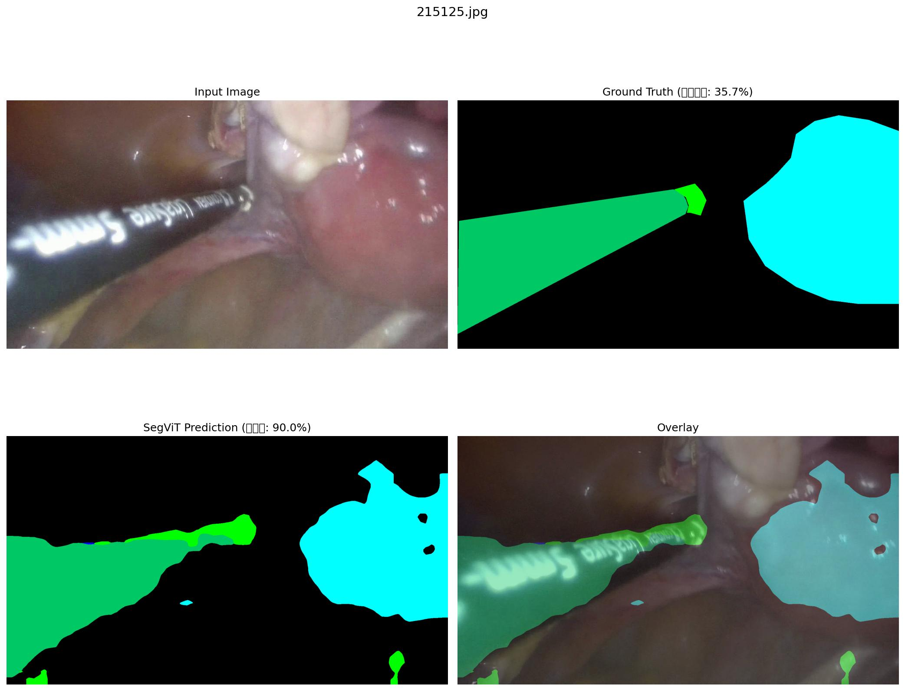
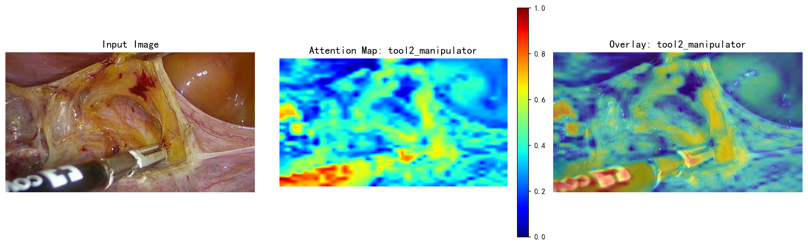

# Baseon_SegVit
# Surgical Instrument Cavity Segmentation Based on SegViT

A surgical instrument cavity segmentation project implemented based on [SegViT](https://github.com/zbwxp/SegViT) (Segmentation with Vision Transformer). It adopts a lightweight ViT backbone network, combined with a segmentation decoder head and custom loss functions, and supports the full pipeline of multi-GPU training, dataset preprocessing, training/testing, and visualization.

## 📁 Repository File Description

```
.
├── backbone/                                       # Lightweight ViT backbone network definition code, responsible for image feature extraction
├── decode_heads/                                   # Segmentation decoder head module
├── losses/                                         # Custom loss function module
├── tools/                                          # Full-pipeline utility scripts
│   ├── dist*.sh                                    # Multi-GPU training launch scripts
│   ├── pre_data_train_val.py                       # Dataset preprocessing
│   ├── train.py                                    # Model training
│   ├── test.py                                     # Model testing
│   └── visual.py                                   # Generate segmentation visualization results
├── best.pth                                        # Optimal binary weight file automatically saved based on validation set metrics
├── segvit.txt                                      # Full training pipeline experiment log and parameter records
├── segvit_4_26.py                                  # Core model configuration file
├── 05_215125_acc_90.0_fg_35.7.jpg                  # Screenshot of the optimal model accuracy metrics
└── attention_tool2_manipulator.png                 # Attention mechanism visualization result
```

## 🔍 Module Description

| File / Directory | Description |
| --- | --- |
| `backbone/` | Stores the lightweight ViT backbone network definition code, responsible for image feature extraction |
| `decode_heads/` | Segmentation decoder head module |
| `losses/` | Custom loss function module |
| `tools/` | Full-pipeline utility scripts |
| `tools/dist*.sh` | Multi-GPU training launch scripts |
| `tools/pre_data_train_val.py` | Dataset preprocessing |
| `tools/train.py` | Model training |
| `tools/test.py` | Model testing |
| `tools/visual.py` | Generate segmentation visualization results |
| `best.pth` | Optimal binary weight file automatically saved during training based on validation set metrics |
| `segvit.txt` | Full training pipeline experiment log and parameter records |
| `segvit_4_26.py` | Core model configuration file, defining hyperparameters such as network architecture, input size, and number of classes |
| `05_215125_acc_90.0_fg_35.7.jpg` | Screenshot of the optimal model accuracy metrics |
| `attention_tool2_manipulator.png` | Attention mechanism visualization result |

## 🧠 Model Architecture

- **Backbone**: Lightweight ViT (Vision Transformer), responsible for image feature extraction
- **Decode Heads**: Segmentation decoder head module
- **Losses**: Custom loss functions
- **Core Configuration**: `segvit_4_26.py`, defining hyperparameters such as network architecture, input size, and number of classes

## 🚀 Quick Start

### Environment Dependencies

> TODO: Add Python, PyTorch, CUDA versions and dependency installation commands

```bash
# Example
pip install -r requirements.txt
```

### Dataset Preprocessing

```bash
python tools/pre_data_train_val.py
```

### Model Training

**Single-GPU training:**

```bash
python tools/train.py --cfg segvit_4_26.py
```

**Multi-GPU training:**

```bash
bash tools/dist_train.sh
```

> TODO: Add the actual script names and parameter descriptions

During training, the optimal weights are automatically saved to `best.pth` based on validation set metrics, and the full pipeline log is recorded in `segvit.txt`.

### Model Testing

```bash
python tools/test.py --cfg segvit_4_26.py --weight best.pth
```

### Result Visualization

```bash
python tools/visual.py --cfg segvit_4_26.py --weight best.pth
```

## 📊 Training Results

Optimal model accuracy metrics:



- **Accuracy**: 90.0
- **FG (Foreground) Metric**: 35.7

> Metric screenshot filename: `05_215125_acc_90.0_fg_35.7.jpg`

## 🎯 Attention Visualization

Visualization results of the model's attention mechanism (surgical instruments):



## 🏆 Optimal Weights

The optimal checkpoint automatically saved during training based on validation set metrics is **`best.pth`**.

## 🙏 Acknowledgements

This project is implemented based on [SegViT](https://github.com/zbwxp/SegViT). We thank the original authors for their open-source work.
